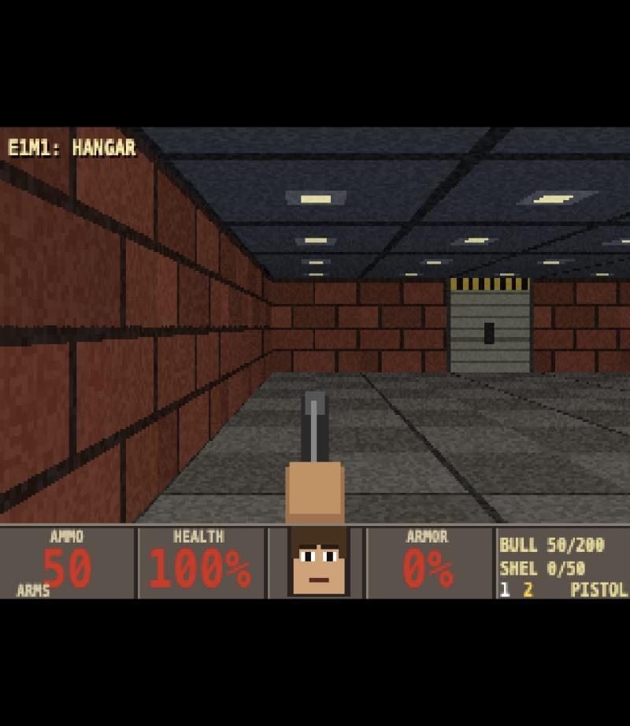
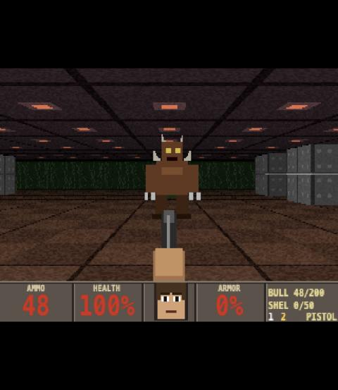

<div align="center">

```
 ██████╗  ██████╗  ██████╗ ███╗   ███╗
 ██╔══██╗██╔═══██╗██╔═══██╗████╗ ████║
 ██║  ██║██║   ██║██║   ██║██╔████╔██║
 ██║  ██║██║   ██║██║   ██║██║╚██╔╝██║
 ██████╔╝╚██████╔╝╚██████╔╝██║ ╚═╝ ██║
 ╚═════╝  ╚═════╝  ╚═════╝ ╚═╝     ╚═╝
          W E B   E D I T I O N
```

**A software-raycaster shooter in the spirit of 1993.**
**320×200. Zero dependencies. Zero downloads. Zero mercy.**

`[ HTML5 CANVAS ]` `[ PURE JAVASCRIPT ]` `[ NO ASSETS - EVERYTHING IS GENERATED ]`

### [>>> PLAY NOW IN YOUR BROWSER <<<](https://xandertaylorx.github.io/doom-web/)



</div>

---

```
 ┌──────────────────────────────────────────────────────────┐
 │  YOU'RE A MARINE. THE HANGAR IS CRAWLING WITH THINGS     │
 │  THAT SHOULDN'T EXIST. YOU'VE GOT A PISTOL, A SHOTGUN    │
 │  YOU HAVEN'T FOUND YET, AND A GREEN EXIT SIGN SOMEWHERE  │
 │  ON THE FAR SIDE OF THE BASE.   GOOD LUCK.               │
 └──────────────────────────────────────────────────────────┘
```

## >> INSERT COIN (HOW TO RUN)

**Fastest:** [click here to play online](https://xandertaylorx.github.io/doom-web/) - no download needed.

Or run it locally. No install. No build. No server.

| PLATFORM | DO THIS |
|----------|---------|
| **macOS**   | Double-click `play-mac.command` *(or just open `index.html`)* |
| **Windows** | Double-click `play-windows.bat` *(or just open `index.html`)* |
| **Linux / anything else** | Open `index.html` in a browser |

Chrome, Edge, Firefox and Safari all work. Click the screen to grab the mouse.

Or from a terminal:

```bash
git clone https://github.com/xandertaylorx/doom-web.git
cd doom-web
open index.html          # macOS
start index.html         # Windows
```

## >> CONTROLS

```
 ╔════════════════════╦══════════════════════════════════╗
 ║ W A S D            ║ MOVE / STRAFE                    ║
 ║ MOUSE  or  ← →     ║ TURN                             ║
 ║ SHIFT              ║ RUN                              ║
 ║ CLICK / CTRL / F   ║ FIRE                             ║
 ║ SPACE  or  E       ║ USE  (DOORS, EXIT SWITCH)        ║
 ║ 1  2  3            ║ FIST / PISTOL / SHOTGUN          ║
 ║ TAB                ║ AUTOMAP                          ║
 ║ M                  ║ MUSIC ON/OFF                     ║
 ║ P  or  ESC         ║ PAUSE                            ║
 ╚════════════════════╩══════════════════════════════════╝
```

## >> THE ARSENAL

| # | WEAPON  | AMMO    | NOTES |
|---|---------|---------|-------|
| 1 | FIST    | -       | Free. Embarrassing. |
| 2 | PISTOL  | BULLETS | Reliable hitscan. |
| 3 | SHOTGUN | SHELLS  | 7 pellets of regret. Find it in E1M1. |

## >> THE BESTIARY

```
  ZOMBIEMAN   HP  20   Shoots you from a distance. Drops a clip.
  IMP         HP  60   Throws fireballs. Claws when you get close.
  PINKY       HP 150   Doesn't shoot. Doesn't need to. FAST.
  BARREL      HP  20   Green. Explosive. Chains into other barrels.
```



## >> LEVELS

- **E1M1: HANGAR** - brick corridors, a hall full of bad ideas, and a long walk to the exit.
- **E1M2: NUKAGE ARENA** - one big pillared room. Everything wakes up. Don't stand still.

Doors wake up anything within earshot, so open them like you mean it.

## >> UNDER THE HOOD

Everything the original did in 1993 with a 386, done here with a canvas:

- **DDA raycasting** for walls, rendered into a 320×200 `Uint32Array` framebuffer and stretched to 4:3 like the original.
- **Floor and ceiling casting** with textured flats.
- **Distance-based lighting** (the classic "darker the farther away" fade) plus muzzle-flash lighting.
- **Sliding doors** that reveal what's behind them while they rise.
- **Billboard sprites** with per-column depth testing, so monsters peek around corners properly.
- **Enemy AI** with line-of-sight, waking, pain states, door-opening, melee and ranged attacks.
- **Procedural everything:** textures, monsters, items, the HUD face, sound effects and the music are all generated at startup. There isn't a single image or audio file in the game itself.
- **WebAudio synth** for gunshots, growls, explosions and a chugging metal riff.

```
 js/
 ├─ core.js       screen, framebuffer, helpers
 ├─ textures.js   brick, tech, metal, marble, doors, flats
 ├─ sprites.js    imp, zombieman, pinky, barrel, pickups
 ├─ audio.js      synthesised SFX + music sequencer
 ├─ levels.js     the maps (ASCII!)
 ├─ world.js      game state, collision, line-of-sight
 ├─ raycast.js    DDA raycaster, floor/ceiling, sprite renderer
 ├─ hud.js        status bar, face, weapons, automap, screens
 ├─ combat.js     weapons, monster AI, projectiles, doors, items
 ├─ input.js      keyboard + mouse + pointer lock
 └─ main.js       update + main loop
```

### Make your own level

Levels are just text in `js/levels.js`:

```
 1 2 3 4 = wall textures      D = door        X = exit switch
 P = player start             . = floor
 z = zombieman  i = imp  p = pinky  b = barrel
 h = medkit  r = armor  a = ammo  s = shotgun
```

## >> KNOWN LIMITATIONS

This is a love letter, not a port. Monsters use a single view instead of 8 rotations, rooms are flat (no stairs or height changes), and there are no keycards or secrets yet. All levels, art and music are original.

## >> ROADMAP

- [ ] More weapons (chaingun, rocket launcher)
- [ ] Keycards and locked doors
- [ ] Secret walls
- [ ] 8-direction monster sprites
- [ ] More levels
- [ ] Gamepad support

---

<div align="center">

```
  RIP AND TEAR.
```

*Not affiliated with id Software. DOOM is a trademark of its respective owners.
This is a fan-made tribute and contains no original game assets.*

</div>
